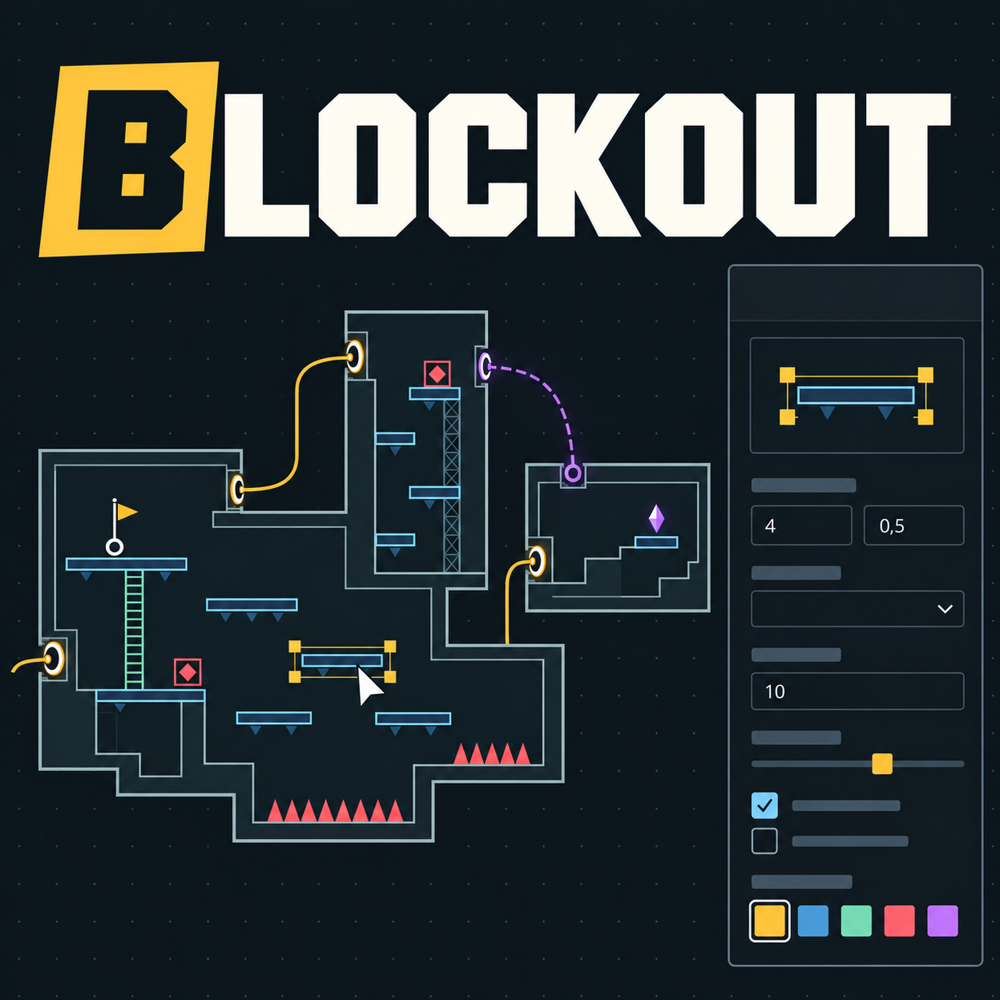

# Blockout Map Constructor

Локальный визуальный конструктор 2D-уровней для платформеров. Проектируйте регионы, комнаты и переходы на карте мира, затем открывайте блокинг комнаты двойным щелчком. Мир, геометрия и настройки сохраняются в одном JSON-проекте.

<p align="center">
  
</p>

## Рабочее пространство

- Панели слева и справа можно свернуть кнопками над холстом или в заголовках. Тяните разделитель, чтобы изменить ширину; двойной щелчок возвращает стандартную. В фокусе разделителя работают стрелки ← →. Ширина и свёрнутость запоминаются в этом браузере отдельно для мира и блокинга, вне файла проекта. На узком окне панели открываются поверх холста.
- В палетке **Объекты** есть поиск; геометрия и логика стоят первыми. Размер примитива показывается при наведении. Во вкладке **Заготовки** остаётся личная библиотека.
- Справа переключаются **Свойства / Слои**. Выбор объекта или инструмента маршрутов открывает свойства. Название текущего слоя над холстом открывает список слоёв.
- **Вид** управляет сеткой, заметками, маршрутами, соседними комнатами и просмотром контуров. Скрытие заметок также исключает их из выделения. Эти переключатели не меняют файл проекта.
- Навигация **Мир → Регион → Комната** возвращает на нужный уровень. В меню названия комнаты сначала показаны связанные комнаты. Основные свойства доступны сразу; привязка и параметры Unreal находятся в раскрывающихся разделах.

## Запуск

Дважды щёлкните по файлу `ЗАПУСТИТЬ_КОНСТРУКТОР.cmd`. Откроется адрес `http://localhost:3000`.

Для остановки сервера закройте окно терминала или нажмите в нём `Ctrl+C`.

## Сборка мира

1. Откройте **Мир**, задайте название проекта в верхней панели. **+ Регион** создаёт группу; справа доступны название, описание и цвет. Регион необязателен — комнаты могут оставаться **Без региона**.
2. Нажмите **+ Комната**. В свойствах задайте название, задачи, регион, тип и готовность. Новая комната начинает без условных входов/выходов: они появляются по точкам, заданным в её блокинге. Отдельные точки можно по-прежнему добавить вручную кнопками **+ Вход** и **+ Выход**.
3. Для прохода потяните линию от пина выхода справа на карточке и отпустите на входе целевой комнаты слева. Можно отпустить прямо на карточке: единственный свободный вход подключится сразу; при нескольких вариантах появится выбор входа, а также кнопка создания нового. По-прежнему работают отдельные клики по выходу и входу. Проход работает **в обе стороны** и хранится одной записью у выхода. Вход принимает только один включённый проход; занятый вход нельзя перехватить другой связью.
4. Выберите выход или линию прохода, чтобы настроить целевую комнату и вход, тип перехода, включение, затемнение, обязательные/блокирующие теги и способности. Прибытие настраивается отдельно у каждого конца: глубина Y, направление взгляда и допустимая коррекция позиции.
5. Соедините пин **GameStart** с нужным входом перетаскиванием или отдельными кликами. Это точка начала игры; тот же вход может одновременно участвовать в обычном проходе. Старт можно также назначить в свойствах входа или GameStart.
6. Откройте **Проверку** над графом. Она показывает ошибки ссылок и ID, занятые входы, отсутствие старта и недостижимые комнаты. Клик по сообщению переводит к объекту. Проверка связности учитывает включённые двусторонние проходы, но не моделирует получение способностей и выполнение игровых условий.

Комнаты перемещаются за заголовок левой кнопкой. Зажатая **ПКМ** перемещает холст одинаково в мире и внутри комнаты, в том числе поверх объектов; колесо меняет масштаб. На карте мира также можно тянуть пустое поле левой кнопкой. **Весь мир** помещает граф в окно. Список слева позволяет найти и показать комнату или регион. Области регионов автоматически охватывают свои комнаты; принадлежность меняется в свойствах комнаты, а не при перетаскивании через границу. Удаление региона оставляет комнаты без группы.

Для переназначения прохода снова потяните за тот же выход: старая связь сохраняется до успешного подключения. `Esc` или отпускание линии на пустом месте отменяют перетаскивание. Переподключение сохраняет тип перехода, затемнение и условия доступа. `Ctrl+Z` отменяет подключение одним действием, включая создание нового входа через выбор на карточке.

В свойствах выхода или выбранной линии раздел **Линия на карте мира** задаёт **Цвет линии** и **Начертание**: сплошное или пунктирное. **Автоматический стиль** возвращает оформление по условиям и состоянию прохода. Настройки сохраняются в полном проекте и при переподключении; на игровые условия и файл для Unreal они не влияют.

Поля **Ширина X, см** и **Высота Z, см** задают ориентировочный размер комнаты. Они не масштабируют геометрию. Положение карточки на графе, размеры в сантиметрах и контур блокинга независимы. В свойствах комнаты можно привязать существующий **Контур в блокинге**. Двойной щелчок по карточке или комнате в списке открывает блокинг; это работает и для комнаты без готового контура.

`Del` удаляет выбранную комнату из графа вместе с её связями; `Ctrl+Z` восстанавливает. При вводе текста клавиша работает с полем. Рисунок удалённой комнаты сохраняется и доступен через **Общий рисунок**. Сохранившимся объектам для дальнейшего импорта нужно явно назначить существующую комнату.

## Управление блокингом

- Перетащите шаблон из палетки слева на карту.
- Колесо мыши — масштаб.
- Зажатая **ПКМ** — перемещение карты; средняя кнопка мыши тоже поддерживается.
- Инструмент **Линия** рисует разметку между узлами сетки. **Маршрут** (`3`) открывает редактор связных путей комнаты.
- `Delete` — удалить выбранное.

В открытой комнате видны её явно назначенные объекты, связанный контур и старые неназначенные элементы внутри него. Новые объекты получают принадлежность текущей комнате; существующие назначения не меняются при переходах между экранами. **Общий рисунок** в мире даёт доступ ко всему прежнему холсту, включая элементы без комнаты.

**Вид → Соседние комнаты** включает полупрозрачные фрагменты у связанных физических входов и выходов. Проходы выравниваются по полу независимо от положения карточек мира; показывается только небольшое окно снаружи текущего контура. Фрагменты не выделяются и не создают копий объектов. По умолчанию опция выключена. Для ручных точек мира без размещения в блокинге фрагмент не строится. **Показать всё** учитывает включённые фрагменты.

**Маршрут → Построить маршрут**: щёлкайте по карте для добавления точек, `Enter` завершает, `Backspace` убирает последнюю точку, `Esc` отменяет построение. В инспекторе можно задать название, назначение (основной путь, ответвление, секрет, возврат) и цвет. У выбранного маршрута точки перетаскиваются, щелчок по отрезку вставляет новую точку, `Del` удаляет выбранную точку либо весь выбранный маршрут. Начало обозначено кружком, конец — квадратом; стрелок нет. Переключатель **Вид → Маршруты** скрывает разметку, а флажки в списке скрывают отдельные маршруты. Изменения отменяются вместе с проектом. Это дизайнерская разметка, а не проверенная траектория прыжка.

Маршруты хранятся в необязательном массиве `routes` полного проекта v2: постоянный `id`, `roomId`, имя, назначение, цвет, видимость и упорядоченные точки в единицах холста относительно верхнего левого угла контура комнаты. При удалении комнаты её маршруты удаляются вместе с ней и восстанавливаются отменой. В экспорт Unreal маршруты не включаются и на отпечаток повторного импорта не влияют. Старые линии/стрелки в чужих проектах сохраняются при чтении.

Во вкладке палетки **Заготовки** можно сохранить выделенную группу, дать ей имя, переименовать, удалить с возможностью возврата и вставить снова. Вставка создаёт новые ID, назначает текущие комнату/слой и выделяет группу в центре вида для перемещения. Контуры комнат, переходы и разметка путей в заготовку не входят; исходные связи с миром не копируются. Библиотека общая для проектов в этом браузере, хранится отдельно от карты и переносится собственными кнопками **Экспорт библиотеки / Импорт библиотеки**. Повторный импорт обновляет заготовки по ID без дубликатов. `Ctrl+Z` отменяет вставку в карту; операции самой библиотеки независимы от истории проекта.

В палетке геометрии есть **OneWay · проход снизу**. Тот же режим можно выбрать в свойствах любой платформы: верхняя сплошная кромка обозначает опору, стрелки вверх — проход снизу. Значение `platformMode: "oneway"` сохраняется в полном проекте. Это схема односторонней платформы; конструктор не симулирует движение персонажа. При переключении обычного сплошного блока в OneWay его назначение меняется на Blueprint. Выключенное назначение остаётся выключенным. Выгрузка OneWay как сплошной коллизии отклоняется; при размещении Blueprint его односторонняя коллизия, размеры и поведение настраиваются в движке, подтип платформы автоматически не применяется.

У **движущейся платформы** размеры площадки задаются отдельно от длины пути: `movingPlatformWidth` и `movingPlatformHeight` в клетках, по умолчанию 3 × 0,5. Маркер показан в масштабе сетки. Точки A/B обозначают крайние положения центра на средней линии рамки пути `x/y/w/h`; `trackPosition` от 0 до 1 задаёт показанное положение. Полный проект сохраняет эти поля и постоянный ID; старые проекты читаются без добавления полей. Это схема без анимации. В Unreal объект можно выгрузить только как Blueprint: существующий якорь остаётся нижним центром рамки пути, а размеры площадки, движение и точки A/B автоматически не применяются. Выгрузка пути как сплошного статического блока отклоняется.

### Входы и выходы из блокинга

В разделе **ЛОГИКА** перетащите **Переход** в открытую комнату. В инспекторе выберите **Вход** или **Выход**, задайте название точки. В общем рисунке сначала назначьте комнату. Точка сразу появляется на соответствующей стороне карточки комнаты в мире; выход можно соединить линией со входом другой комнаты.

Для точки на границе выберите сторону формы комнаты, сделайте её **Дверью** или **Проходом**, затем назначьте вход или выход в инспекторе перехода. Без этого назначения сторона остаётся обычным проёмом. Дверной Blueprint, если он нужен, размещается отдельным объектом.

Перемещение, изменение размеров и вытягивание стороны сохраняют ID точки и её связи. При разделении стороны прежняя точка остаётся на первой половине; новая половина не получает второй переход автоматически. Копирование создаёт новые независимые точки. Удаление объекта или назначенной стороны, снятие роли либо смена роли очищают затронутые связи и GameStart в конструкторе; **Ctrl+Z** восстанавливает рисунок, точки и связи вместе. Ранее созданные вручную точки не удаляются вместе с рисунком. Удаление связанной точки в инспекторе мира снимает её назначение в блокинге.

При экспорте **Переходы и условия** включают и эти автоматически созданные точки. Сам значок перехода не создаёт физический блок или Blueprint. Положение маркеров в Unreal пока задаётся в движке; прежний импортёр сохраняет удалённые endpoints и блокирует перенос уже импортированного ID между картами. Это обновление связывает блокинг с графом конструктора.

## Сохранение и отмена

- В обоих режимах кнопки **↶ / ↷** и `Ctrl+Z` / `Ctrl+Y` отменяют и повторяют изменения проекта. Текстовые и числовые свойства мира применяются при выходе из поля или по `Enter`; для многострочного описания — `Ctrl+Enter`.
- Проект автоматически сохраняется в текущем браузере; состояние видно в верхней панели. **Экспорт → Полный проект** сохраняет файл версии 2 со всем графом мира и рисунком. **Импорт** читает проекты версий 1 и 2; импорт можно отменить. Файл для Unreal содержит выбранные категории и не заменяет резервную копию полного проекта.
- При открытии старого сохранения версии 1 контуры комнат добавляются в каталог мира. Исходные ID объектов, геометрия, слои, линии и привязки объектов сохраняются. Для новых записей каталога создаются собственные постоянные ID; нарисованные линии не превращаются в игровые проходы автоматически.
- Автосохранение версии 2 использует отдельную запись браузера. Прежняя запись версии 1 остаётся как резервная копия. Для переноса на другой компьютер или в другой браузер используйте JSON.

## Связь с Unreal Engine

Экспорт **Для Unreal** сохраняет описание мира и выбранные категории объектов в JSON. Для создания ассетов и геометрии в Unreal Engine нужен отдельный совместимый импортёр; его исходники не входят в этот репозиторий. Сам конструктор работает независимо от движка.

Ниже описан обмен с таким импортёром: общий каталог комнат, необязательные регионы, независимые входы/выходы, одна запись двустороннего прохода и отдельный GameStart.

1. Нажмите **Экспорт**, выберите **Для Unreal** и содержимое файла: без геометрии, только контуры комнат или вся геометрия; отдельно — переходы и условия, объекты Blueprint и противники. Скачайте файл после проверки ошибок. Каталог мира, регионы и комнаты передаются всегда; постоянные ID сохраняются. Старый JSON версии 1 сначала откройте в конструкторе, чтобы закрепить ID комнат.
2. В совместимом импортёре Unreal Engine нажмите **Import MapConstructor…**, выберите JSON и папку первого импорта (по умолчанию `/Game/MapConstructor`).
3. Нажмите **Preview Import**. Список показывает реальные пути, новые и изменяемые данные, сохранённые ручные правки, отсутствующие в источнике записи и конфликты. Предпросмотр не создаёт ассеты. **Apply Import** применяет проверенный список и сохраняет затронутые пакеты; изменение файла или ассетов после предпросмотра требует нового сравнения.

Категория **Переходы и условия** переносит входы/выходы, связи, теги и способности проходов, параметры прибытия и GameStart. **Объекты Blueprint** переносит точки размещения дверей, лестниц, чекпоинтов и других игровых объектов; **Противники** — противников и боссов. Их классы выбираются в Unreal. Для новых комнат создаются отдельные обычные `.umap`, контроллер и необходимые маркеры. Зоны камеры могут строиться по контуру; расположение маркеров и художественные параметры камеры задаются в Unreal. Оболочка мира и стартовые карты проекта автоматически не назначаются.

Файл для движка имеет формат `mapconstructor-unreal`, версию 3 и явный `exportScope`. Старый импортёр, который ещё не знает частичного экспорта, отклонит такую версию. Полный редактируемый проект остаётся v2; актуальный импортёр Unreal также принимает прежние v2-файлы. Выключенная категория означает «не обновлять эти данные», а не «удалить их»: например, экспорт одних контуров сохраняет платформы, Blueprint-объекты и переходы, уже настроенные в движке.

Постоянный ассет `DA_ImportManifest` связывает ID источника с конкретными ассетами и акторами. Повторная загрузка того же мира, включая переименование JSON или выбор другой папки, использует прежние пути. Новые записи создаются для новых ID; сторонний ассет на ожидаемом пути вызывает конфликт. Не удаляйте манифест для «сброса» импорта.

При неизменном источнике ручные правки в Unreal сохраняются. Изменения с обеих сторон вызывают конфликт, который нужно разрешить до применения. Посторонняя геометрия карты и размещение маркеров не перезаписываются. Удалённые комнаты, регионы и переходы сохраняются с пометкой Retain; для управляемого блокинга действуют отдельные правила ниже. Поле **Каталог новых ассетов** мира задаёт настройку дальнейшего ручного создания в редакторе движка; папка первого импорта выбирается отдельно.

Gameplay Tags должны существовать в проекте Unreal — импортёр проверяет их перед применением. Перед записью существующих пакетов движок сохраняет копии в `Saved/MapConstructorImportBackups`.

### Масштаб и геометрия блокинга

1. В свойствах мира или комнаты откройте **Масштаб и геометрия** и задайте **Одна клетка, см**, глубину по Y и толщину стен. Одна клетка рисунка равна 32 единицам холста; масштаб просмотра значения не меняет. Предложенные 100 см на клетку можно заменить своим масштабом. Состав переноса выбирается только в окне экспорта.
2. У каждой используемой комнаты задайте фиксированное **Начало координат блокинга**. Кнопка **Из нижнего левого угла контура** копирует текущую точку один раз. Дальнейшие правки контура не сдвигают начало автоматически.
3. Выберите объект или группу и задайте **Комната мира** и **Представление в Unreal**. Это назначение независимо от «Следовать за контуром». Команда **Подготовить комнату** назначает её контур и обычные платформы, полностью находящиеся только внутри этого контура, сохраняя прежние назначения. Неоднозначные объекты нужно назначить вручную.
4. В **Экспорт → Для Unreal** выберите нужную геометрию и проверьте **Preview Import** в Unreal. Перед применением сохраните свои правки затрагиваемых карт.

**Сплошной блок** создаёт прямоугольник или простой, в том числе вогнутый, многоугольник с коллизией. **Стены по контуру** оставляют внутренность комнаты пустой; стороны «Дверь» и «Проход» целиком открыты. «Ломаемая» переносится как обычная стена. Это статический блокинг: логика воды, урона, врагов, дверей и движения платформ не создаётся. Линии/стрелки не являются физической геометрией. Видимость слоя не исключает объект из импорта.

Координаты уровня: `X = (canvasX - originX) × centimetersPerCell / 32`, `Z = -(canvasY - originY) × centimetersPerCell / 32`; глубина симметрична Y=0. Положение карточки и ориентировочный размер комнаты не участвуют в расчёте. Для каждого исходного объекта создаётся один runtime-актор: изменения размеров, контура и масштаба обновляют его по прежнему ID.

Удаление исходного объекта или режим **Не импортировать объект** дают действие **Delete** только внутри выбранной категории и только для прежнего принадлежащего импортёру актора без ручных изменений. Ручное перемещение, изменение формы, материала, коллизии или добавленные дочерние объекты блокируют такое удаление. Исключение всей категории в окне экспорта сохраняет ранее импортированные объекты этой категории. Смена комнаты уже импортированного объекта блокируется: сначала исключите сам объект из импорта, экспортируйте его категорию и примените показанное удаление, затем назначьте новую комнату и импортируйте снова.

Поля проекта JSON v2: `blocking` хранит масштаб и параметры геометрии; `world.rooms[].blockingOrigin` — фиксированную точку в единицах холста; `items[].blocking` — комнату и режим (`solid`, `outline`, `blueprint`, `none`). Прежний `blocking.enabled` сохранён для совместимости старых файлов; новый экспорт задаёт состав через `exportScope`. Самопересечения выбранной физической геометрии, вырожденные контуры, неверные ссылки и значения масштаба отклоняются до применения.

### Двери, лестницы и другие Blueprint-объекты

1. Выберите предмет, назначьте комнату и **Разместить Blueprint**. Контуры комнат, заметки и комментарии этот режим не поддерживают. Для игровой двери нужен отдельный предмет «Дверь»: сторона контура «Дверь» только оставляет проём.
2. В **Экспорт → Для Unreal** включите **Объекты Blueprint** (для врагов и боссов — **Противники**) и скачайте файл. В Unreal нажмите **Preview Import**: появится список использованных типов, например `door`, `ladder`, `checkpoint`.
3. Выберите Actor Blueprint для каждого типа. При необходимости задайте смещение X/Y/Z в сантиметрах для его pivot. Повторите **Preview Import**, затем примените проверенный результат. Соответствия сохранятся для этого мира и будут подставляться при следующем импорте.

Точка установки — нижний центр габаритов значка, пересчитанный через начало комнаты и масштаб. Blueprint сохраняет собственный размер: растягивание значка меняет точку установки, но не масштаб актора. Импорт переносит только размещение; значения ключей, замков, урона и другие игровые данные из рисунка пока не передаются. Работают свойства по умолчанию и логика выбранного Blueprint.

Повторная загрузка сохраняет ID и обновляет прежний актор. Ручные изменения в Unreal защищены тем же сравнением, что и геометрия. Для смены класса уже импортированного предмета сначала выключите импорт самого предмета, экспортируйте его категорию и примените показанное удаление, затем включите с новым соответствием. Смена комнаты выполняется таким же способом. Выключение категории сохраняет созданные акторы.

### Зоны камеры по форме комнаты

В импорте Unreal включён **Camera zones from room outlines**. Для генерации привяжите основной контур к комнате, назначьте ему ту же комнату и **Стены по контуру комнаты**, затем включите контуры в экспорт геометрии. Команда **Подготовить комнату** выполняет нужное назначение для существующего контура.

Импортёр разбивает форму на несколько прямоугольных зон камеры. Например, пьедестал с высоким центральным выступом даёт три зоны. Прямоугольные уступы описываются точно, а наклонный участок охватывается одним прямоугольником целиком, без ступеней. **Padding, cm** добавляет запас по всем краям каждой зоны (по умолчанию 10 см). Настройки сохраняются отдельно для каждого импортированного мира.

В **Preview Import** видны создание, изменение и удаление частей. Повторная загрузка обновляет прежние зоны без дубликатов; ручные изменения защищены сравнением. Если старую единственную зону уже настраивали в Unreal, её автоматическая замена блокируется конфликтом. Выключение генерации сохраняет созданные зоны. Для переходов камера использует их объединение; небольшой запас не заменяет необходимую ширину прохода для полного кадра.

## Разработка

Требуется Node.js 22.13 или новее.

```text
npm install
npm run dev
```

Проверки редактора:

```text
npm run typecheck:editor
npm test
```

`typecheck:editor` проверяет типы редактора. `npm test` собирает приложение и запускает проверки модели мира, миграции/чтения JSON, подготовки экспорта Unreal и начальной страницы.
